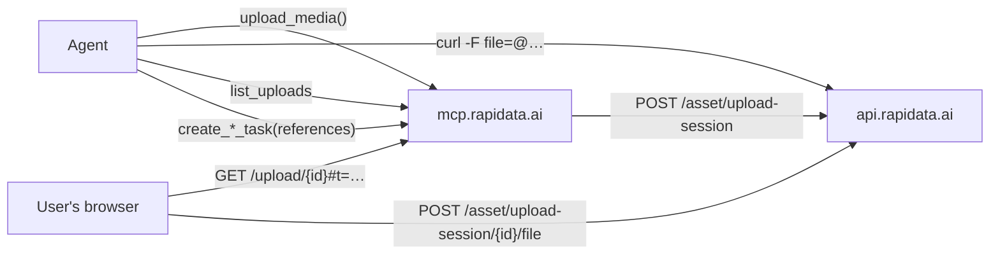

# Rapidata MCP Server

A **hosted, multi-tenant [MCP](https://modelcontextprotocol.io) server** that exposes Rapidata
human-labeling tasks to customers' own AI agents — Claude Desktop, Cursor, IDE assistants, or any
custom MCP client. Point your agent at the server, authenticate once in the browser, and it can
create, run, monitor, and read the results of labeling tasks through tool calls.

This is **Stage 1** of the Rapidata MCP product, and it ships directly as a **remote** server over
the **Streamable-HTTP** transport. There is no local/stdio product.

Public endpoint: **`https://mcp.rapidata.ai/mcp`**

## Tools

Tasks run as **jobs** on Rapidata: a create tool produces a **job definition** (a draft template), and `start_job` runs that definition on an **audience** (global unless it names another), producing a **job** you then poll and read.

| Tool | Purpose |
|---|---|
| `upload_media` | Turn media into **asset references**: imports public URLs or ChatGPT attachments, or opens an upload link for local files. **No spend.** |
| `list_uploads` | The references of the files uploaded to an upload link. |
| `create_classification_task` | Humans pick one option per item. Creates a draft job definition with its dollar estimate and the credit left — **no spend**. `keep_option_order` stops shuffling the options (for scales). |
| `create_comparison_task` | Pairwise comparison (choose between two). Creates a draft job definition with its dollar estimate and the credit left — **no spend**. |
| `start_job` | Run a draft job definition — **the single step that spends.** `audience_id` (default `global`, or a curated or dashboard-built audience) and optional `filters` (countries, languages). |
| `get_job_status` | Status and percent done. |
| `get_job_results` | Partial once paused, final once complete; **never blocks.** |
| `list_jobs` | Your most recent jobs. |
| `pause_job` / `resume_job` | Stop collecting (and spending), and continue. |
| `get_account_balance` | Credit left, spend this period, spending cap, amount owed. |

Both create tools take the same core parameters: the **question** (`instruction`), optional per-datapoint **`contexts`** (text shown alongside the question), **`responses_per_datapoint`**, and — classification only — the **`answer_options`**. Media is given as asset references: `comparison_pairs` (two per pair, required) for comparison, and `datapoint_references` for classification — where it is **optional**, for a genuinely text-only question: omit it and the crowd answers the instruction on its own against a generic placeholder image.

### Media: upload first, then pass references

The create tools take **asset references only** — the file name the Rapidata asset service gives an upload (e.g. `3f2a9c1e-5b7d-4e2a-9c1f-0d8e7a6b5c4d.png`). They reject URLs and file paths with an error that points at `upload_media`, and upload nothing themselves. `upload_media` makes the references, whatever the media's source:

| Source | Call | What comes back |
|---|---|---|
| Public URLs | `upload_media(urls=[…])` | One reference per URL, imported right away. |
| Files attached in ChatGPT | `upload_media(files=[…])` — ChatGPT fills `files` itself (`_meta["openai/fileParams"]`) | One reference per file. |
| Local files | `upload_media()` | A one-hour upload link: `curl_command` and `upload_page_url`. |

For local files, an agent with a shell runs `curl_command` once per file; each run prints JSON with that file's reference as `fileName`. One file per request is deliberate: the API rejects a request body over 100 MB, and one rejected file fails the whole request. In a chat client without file access, the user opens `upload_page_url`, drops the files and returns to the chat; the agent then calls `list_uploads(upload_session_id)`. The link accepts up to 100 files of at most 50 MB each for one hour, and its uploads stay listable for 7 days. Its upload token travels in the URL fragment (`#t=…`), so it never reaches this server's logs.



Two invariants hold across the tool layer:

- **Spending is explicit.** Creating a task never spends. `create_*` returns a draft with
  `confirmation_required` and `total_responses` (datapoints × responses_per_datapoint) as the honest
  cost driver; `start_job` is the only step that spends. The create response instructs the agent to
  confirm the cost with the user and review the `details_url` before starting. Billing is pre-paid,
  pay-as-you-go for individual (non-organization) accounts, and new sign-ups get **$20 in free
  credit** — so trying these tools out is free.
- **Results never block.** `get_job_results` returns the final results once complete, the partial
  snapshot if the job is paused, and a pollable `result_status` (`not_started`, `collecting`,
  `manual_review`, …) while it is still processing. Per-annotator detail is dropped unless
  `include_details=true`, and the datapoint list is capped (`max_datapoints`).

## Beyond these tools: the full SDK

These MCP tools are a deliberately small, safe slice — classification and comparison on the
global, a curated or a dashboard-built audience, narrowed by country or language. The [Rapidata Python SDK](https://docs.rapidata.ai/) (`rapidata`) is far more
powerful and is the right tool once you outgrow the two task types here:

- **Every task type** — ranking, draw, locate, free text, select words, timestamp (not just
  classify/compare).
- **Building custom audiences** — train annotators on qualification examples, and target by
  age, gender, device, and more.
- **Benchmarks / leaderboards (MRI)**, **flows** (continuous ranking), and **confidence stopping**.
- **Richer results** — per-annotator reliability (`userScore`), demographics, and
  `to_pandas()` / `to_json()` helpers.

To let an agent drive the full SDK directly (no manual coding), install the official
**Rapidata skill** ([`RapidataAI/skills`](https://github.com/RapidataAI/skills)). In Claude Code:

```
/install-plugin https://github.com/RapidataAI/skills
```

For other agents (Cursor, Windsurf, Copilot, …) and details, see the
[AI agents guide](https://docs.rapidata.ai/ai_agents/).

## Authentication

The server is an **OAuth 2.0 Protected Resource** ([RFC 9728](https://datatracker.ietf.org/doc/html/rfc9728)).
Each customer authenticates their MCP client once; every request then carries a bearer JWT that the
server validates and uses to scope all data access to that customer. A compliant MCP client
(Claude Desktop, Cursor, the MCP Inspector, …) drives the whole flow automatically once you give it
the server URL — the steps below are what happens under the hood.

### 1. Discover the authorization server

An unauthenticated request gets a `401` with:

```
WWW-Authenticate: Bearer ..., resource_metadata="https://mcp.rapidata.ai/.well-known/oauth-protected-resource"
```

Fetching that metadata document returns:

```json
{
  "resource": "https://mcp.rapidata.ai",
  "authorization_servers": ["https://auth.rapidata.ai/"],
  "scopes_supported": ["openid", "profile", "email", "roles", "offline_access", "mcp", "api"],
  "bearer_methods_supported": ["header"]
}
```

So the authorization server is **`https://auth.rapidata.ai`**.

### 2. Register a client (Dynamic Client Registration)

Rapidata's authorization server supports **open Dynamic Client Registration**
([RFC 7591](https://datatracker.ietf.org/doc/html/rfc7591)). Your MCP client self-registers a public
PKCE client at:

```
POST https://auth.rapidata.ai/client/register
```

The authorization-server discovery document
(`https://auth.rapidata.ai/.well-known/oauth-authorization-server`) advertises it as
`registration_endpoint`, so clients that rely on discovery find it on their own.

### 3. Authorization Code + PKCE

Run the standard authorization-code flow with PKCE:

- **Scopes:** request `openid email roles offline_access mcp api`.
  (`offline_access` yields a refresh token so the client can stay connected without re-prompting;
  `roles` and `email` identify the customer; `mcp` carries the MCP server as an OAuth resource so
  the authorization server accepts the RFC 8707 resource indicator the client sends for this server;
  `api` carries the backend API as a resource so the forwarded token stays valid at the API once it
  enforces audiences.)
- One-time browser consent, then the client exchanges the code (with its PKCE verifier) for an
  access token and a refresh token.

The resulting access token's `sub` claim is the Rapidata **CustomerId**. The server exchanges it
([RFC 8693](https://datatracker.ietf.org/doc/html/rfc8693)) for an API token and sends only that
token to the Rapidata API gateway, which scopes orders/assets to that customer.

### What the server validates

For every request the server:

1. Reads the `Authorization: Bearer <jwt>` header.
2. Verifies the JWT signature against the JWKS published by `https://auth.rapidata.ai` (resolved via
   its OIDC discovery document), checks the issuer, and checks expiry.
3. Extracts `sub` as the CustomerId and builds a per-request, token-scoped Rapidata client.

A valid, unexpired, correctly-issued token is required; no specific scope is *enforced* beyond that
(the metadata advertises which scopes a client should request).

## Connecting a client

### Claude Desktop / Cursor (and other MCP clients with remote support)

Add a remote MCP server pointing at `https://mcp.rapidata.ai/mcp`. The client performs discovery,
registration, and the browser consent flow for you.

### MCP Inspector (for testing)

```bash
npx @modelcontextprotocol/inspector
```

Enter the URL `https://mcp.rapidata.ai/mcp`, transport **Streamable HTTP**, and complete the OAuth
prompt.

### Getting new tools after an update

Clients cache the tool list, and this server cannot tell them it changed: it is stateless, so
it never sends `notifications/tools/list_changed`. An existing connection picks up new or changed
tools only when its client reads the list again:

| Client | How to get the new tools |
|---|---|
| Claude (web, desktop and mobile apps) | Start a new chat about an hour after the update. If the tools are still missing, use **Refresh tools list** on the connector, or **Disconnect** and connect again. As a last resort, remove the connector and add it again as `https://mcp.rapidata.ai/mcp?v=2`; any new query string works, and you sign in again. |
| Claude Code | Start a new session, or run `/mcp` and select **Reconnect**. |
| ChatGPT | Published app: OpenAI rescans the server daily, and new tools appear once they pass its automated checks. Custom connection: open it under **Plugins**, select **Refresh**, then start a new conversation. |
| Codex (ChatGPT apps) | Start a new session or run `/apps`. Codex offers the tools that ChatGPT has. |
| Cursor | Quit Cursor completely and reopen it, or remove the server and add it again. |

`curl https://mcp.rapidata.ai/health` shows the version that is live. Agents that read the server
instructions, such as Claude Code, also get it on the last line of those instructions.

## Configuration

| Variable | Default | Purpose |
|---|---|---|
| `RAPIDATA_MCP_RESOURCE_URL` | `https://mcp.rapidata.ai` | This server's public resource identifier. |
| `RAPIDATA_MCP_ISSUER_URL` | `https://auth.rapidata.ai` | The authorization server (issuer). |
| `RAPIDATA_MCP_SCOPES` | `openid profile email roles offline_access` | Advertised `scopes_supported`. |
| `RAPIDATA_MCP_CLIENT_ID` | `rapidata-mcp-server` | OIDC client this server exchanges tokens as. |
| `RAPIDATA_MCP_CLIENT_ASSERTION_FILE` | _(unset)_ | Path to a JWT (the pod's projected service-account token) the client authenticates with; re-read on every exchange. When this or the secret is set, the caller's token is exchanged (RFC 8693) at `<issuer>/connect/token` for an API token; with neither, the caller's token is forwarded. |
| `RAPIDATA_MCP_CLIENT_SECRET` | _(unset)_ | **Local dev only.** Client secret, used when no assertion file is set. |
| `RAPIDATA_MCP_API_RESOURCE` | `https://api.rapidata.ai` | API audience requested in the exchange (`https://api.rabbitdata.ch` on test). |
| `RAPIDATA_ENVIRONMENT` | _(SDK default)_ | Rapidata SDK environment to target. |
| `HOST` / `PORT` | `0.0.0.0` / `8000` | Bind address. |
| `LOG_LEVEL` | `INFO` | Logging level. |
| `RAPIDATA_MCP_IMAGE_TAG` | _(unset → `dev`)_ | Set by the image build to the tag it pushes. The server reports it, with the rapidata SDK version, as its version. |
| `OTEL_EXPORTER_OTLP_ENDPOINT` | _(unset → no export)_ | OTLP/gRPC collector for the traces: one span per tool call (service `rapidata-mcp-service`), a child span per API call, continued by the backend. |
| `RAPIDATA_MCP_AUTH_DISABLED` | _(unset)_ | **Local dev only.** Serve without auth using ambient SDK credentials (`RAPIDATA_CLIENT_ID` / `RAPIDATA_CLIENT_SECRET`). |

## Endpoints

| Path | Auth | Purpose |
|---|---|---|
| `POST/GET/DELETE /mcp` | Bearer JWT | The MCP Streamable-HTTP endpoint. |
| `GET /.well-known/oauth-protected-resource` | none | RFC 9728 protected-resource metadata. |
| `GET /upload/{id}` | none (the page's uploads carry the link's upload token) | Static page that uploads dropped files to an `upload_media` link. |
| `GET /health` | none | Liveness/readiness probe → `{"status":"ok","version":"2026.11.12.1640-0a5dfdf · rapidata 3.30.0"}`. |

The upload sessions themselves live on the Rapidata API, not here: `POST /asset/upload-session`
and `GET /asset/upload-session/{id}/files` (called by the tools with the exchanged API token), and
`POST /asset/upload-session/{id}/file` (called by curl or the page with `X-Upload-Token`).

## Local development

```bash
uv sync --group dev

# Serve without auth, using ambient SDK credentials, for local testing:
RAPIDATA_MCP_AUTH_DISABLED=1 \
RAPIDATA_CLIENT_ID=... RAPIDATA_CLIENT_SECRET=... \
uv run rapidata-mcp
# → http://localhost:8000/mcp  (no OAuth; do NOT use in production)
```

Type-check and lint:

```bash
uv run pyright
uv run ruff check src tests
uv run pytest
```

## Docker

```bash
docker build -t rapidata-mcp .
docker run -p 8000:8000 \
  -e RAPIDATA_MCP_RESOURCE_URL=https://mcp.rapidata.ai \
  -e RAPIDATA_MCP_ISSUER_URL=https://auth.rapidata.ai \
  rapidata-mcp
```

The image installs exactly `uv.lock`, and `pyproject.toml` pins the `rapidata` SDK exactly,
so one commit always builds the same image. Each stable SDK release fires `pin-sdk.yml`,
which opens a PR bumping the pin and the lock, runs the tests and the image smoke test,
and merges it; if they fail, the PR stays open for a human and prod keeps the old SDK.

Every push to `main` is a version: `build-image.yml` tags the commit
`YYYY.MM.DD.HHMM-<sha7>` (UTC), builds and smoke-tests the image under that same tag,
pushes it, then bumps the test and prod overlays in `infrastructure`, which ArgoCD syncs.

`--build-arg RAPIDATA_MCP_IMAGE_TAG=2026.11.12.1640-0a5dfdf` names the build; CI passes
the version. The server reports it with the installed SDK version, e.g.
`2026.11.12.1640-0a5dfdf · rapidata 3.30.0`, in three places: `GET /health`,
`serverInfo.version` in the `initialize` response, and the last line of the server
instructions. Without the build arg it reports `dev`. To see what is deployed:

```bash
curl https://mcp.rapidata.ai/health
```

## Architecture

```
client ──Bearer JWT──▶ /mcp ──▶ RequireAuth ─▶ FastMCP tools
                         │           │              │
                         │      JWTVerifier      provider_factory()
                         │   (JWKS, iss, exp)    get_access_token() ─▶ ExchangedTokenProvider
                         │                              │
                         ▼                              ▼
          /.well-known/oauth-protected-resource   RapidataClient(token=api token) ─▶ Rapidata API gateway
```

- `tools.py` — the 9 tools; transport- and auth-agnostic, resolved through a `ClientProvider`.
- `uploads.py` — asset-reference checks and the API's upload-session endpoints.
- `auth.py` — the client-resolution seam (`ExchangedTokenProvider` for hosted, `EnvClientProvider`
  for local dev).
- `token_verifier.py` — JWT validation against the issuer's JWKS (`TokenVerifier`).
- `server.py` — the Streamable-HTTP + OAuth resource-server shell, per-request client wiring, and
  the upload page (`upload_page.html`).

## Scope (Stage 1)

Media as asset references (from URLs, ChatGPT attachments or local files), classification +
comparison only, existing audiences narrowed by country or language only, no validation sets / signals / flows /
leaderboards. Those are later stages, and
the full [Rapidata SDK](https://docs.rapidata.ai/) covers them today (see "Beyond these tools"
above). `sdk_coverage.toml` lists every public SDK function as exposed by a tool or left out
with the reason; a test fails when it misses one, and each SDK release that adds or drops one
opens an issue. Built on the SDK's `job` + `audience` API: each create tool makes a job definition, and
`start_job` assigns it to the chosen audience.

## License

Licensed under the [Apache License 2.0](LICENSE).
